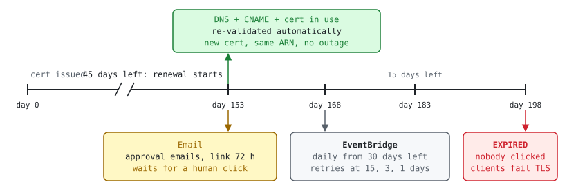

A common outage: an ACM certificate used **email validation**, nobody clicked the
renewal email, and the cert **expired**. The fix is to move to **DNS validation**
so renewal is fully automatic. This post explains the whole story from zero,
assuming no background on certificates.

## TL;DR

- A TLS certificate proves "this server really is `app.example.com`". Before a
  CA (here: Amazon) issues or renews one, it must check that **you control the
  domain**. That check is **domain validation**.
- ACM offers three ways: **Email** (a human clicks a link), **DNS** (you add one
  CNAME record once) and **HTTP** (your site redirects a
  `/.well-known/pki-validation/…` URL to ACM). HTTP works **only for certs used
  with CloudFront** and has no wildcards. For ALB/EKS the real choice is Email vs DNS.
- **Email-validated certs are not renewed automatically.** ACM emails
  `admin@`, `administrator@`, `hostmaster@`, `postmaster@` and `webmaster@` the
  domain, starting 45 days before expiry. If nobody clicks (the link is valid
  72 h), the cert **expires**.
- **DNS-validated certs renew automatically** as long as the CNAME stays in DNS
  **and** the cert is in use (attached to an ALB, CloudFront…).
- You **cannot switch** an existing cert from email to DNS. You request a **new**
  DNS-validated cert, attach it, then delete the old one. New cert = **new ARN**.
- Since 2026-02-18, ACM public certs live only **198 days** (was 395), following
  the CA/Browser Forum rules. Renewal now happens about twice a year, and
  validity keeps shrinking (100 days in 2027, 47 days in 2029). Automation is
  no longer optional.

## 1. Basic concepts

| Term | Plain meaning |
| --- | --- |
| TLS / SSL certificate | A signed file that says "this public key belongs to `app.example.com`, valid from A to B". Browsers trust it because a trusted **CA** signed it. |
| CA (Certificate Authority) | The organization that signs certs. For ACM public certs it is Amazon Trust Services. |
| ACM (AWS Certificate Manager) | AWS service that requests, stores and renews certs and plugs them into ALB, NLB, CloudFront, API Gateway. Free for public certs. You never see the private key. |
| Domain validation (DV) | Proof that you control the domain, done at **issue time and again at every renewal**. |
| Expiry (`NotAfter`) | After this date browsers show "Your connection is not private"; API clients fail with `x509: certificate has expired`. |
| Managed renewal | ACM re-issues the cert before expiry and swaps it in place on the same ARN. Fully automatic only for DNS-validated, in-use certs. |
| ARN | The ID of the cert, e.g. `arn:aws:acm:eu-central-1:111122223333:certificate/abcd-…`. ALB listeners, Ingress annotations and Terraform refer to it. |
| CNAME record | A DNS record "name A is an alias of name B". DNS validation uses one. |

See [ACM concepts](https://docs.aws.amazon.com/acm/latest/userguide/acm-concepts.html).

## 2. Email vs DNS vs HTTP validation

|  | Email | DNS | HTTP |
| --- | --- | --- | --- |
| How you prove ownership | ACM emails 5 fixed addresses at the domain (or a parent domain you choose). Someone clicks **Approve**. | One CNAME: `_<token>.app.example.com → _<token>.acm-validations.aws.` | A redirect from `http://app.example.com/.well-known/pki-validation/<token>.txt` to an ACM URL. The CA fetches the first URL and follows the redirect. |
| Lifetime | Approval link expires after **72 h**; can be resent | Record stays forever; one record also covers `*.app.example.com` | Redirect stays forever; **one per name**; **no wildcards** |
| Renewal | **Manual**: a human must click again **every renewal** | **Automatic** while the CNAME exists and the cert is in use | **Automatic** while the redirect exists and the cert is in use **with CloudFront** |
| Typical failure | Mailbox doesn't exist, belongs to someone who left, spam filter, email ignored, link expired | Someone deletes the CNAME; cert detached from every service; CAA record blocks Amazon | Redirect removed in a CDN config change; cert detached from CloudFront |
| Infra as code | Impossible (human step) | Fully in Terraform | Partly: you configure the redirect yourself |
| When to use | Only when you cannot edit DNS at all | **Default choice**, AWS recommends it | CloudFront sites where you don't control the customer's DNS |

See [Email validation](https://docs.aws.amazon.com/acm/latest/userguide/email-validation.html),
[DNS validation](https://docs.aws.amazon.com/acm/latest/userguide/dns-validation.html) and
[HTTP validation](https://docs.aws.amazon.com/acm/latest/userguide/http-validation.html).

> **Same idea outside AWS:** Let's Encrypt and cert-manager (ACME) use the same
> two automated checks: **HTTP-01** (serve a token at
> `/.well-known/acme-challenge/<token>`, no wildcards) and **DNS-01** (TXT record
> `_acme-challenge.<domain>`, wildcards OK). Rule of thumb everywhere:
> DNS = most flexible, HTTP = easy if the site is already public on port 80,
> Email = manual ([challenge types](https://letsencrypt.org/docs/challenge-types/)).

## 3. Timeline of a renewal (198-day cert)



- ACM starts renewal **45 days** before expiry for 198-day certs (60 days for the
  old 395-day certs) ([What's New, 2026-02-18](https://aws.amazon.com/about-aws/whats-new/2026/02/aws-certificate-manager-updates-default)).
- EventBridge `ACM Certificate Approaching Expiration` is sent **daily** from
  **30 days** before expiry for public certs; change the window with
  `aws acm put-account-configuration --expiry-events DaysBeforeExpiry=N`
  ([ACM EventBridge events](https://docs.aws.amazon.com/acm/latest/userguide/supported-events.html)).
- `ACM Certificate Renewal Action Required` (reason e.g.
  `PENDING_DOMAIN_VALIDATION`, `CAA_ERROR`) is sent at each renewal attempt that
  needs you ([AWS blog](https://aws.amazon.com/blogs/security/how-to-manage-certificate-lifecycles-using-acm-event-driven-workflows/)).
- **An expired cert cannot be renewed.** You must request a new one
  ([Managed renewal](https://docs.aws.amazon.com/acm/latest/userguide/managed-renewal.html)).

## 4. Anatomy of the incident

1. **Setup:** a cert for `app.example.com` in ACM, **email** validation, attached
   to an ALB through the Ingress annotation `alb.ingress.kubernetes.io/certificate-arn`.
2. **Day −45:** ACM sends approval emails to `admin@example.com` and the others.
   Nobody reads that mailbox, it doesn't exist, or the mail lands in spam.
3. **Day −30 → −1:** AWS Health and EventBridge events fire, but no rule routes
   them to chat or paging, so nobody sees them.
4. **Day 0:** the cert expires. Browsers show a warning; services and webhooks
   calling the endpoint fail TLS.
5. **Short-term fix:** request a **new** cert with DNS validation, add the CNAME,
   wait for `ISSUED` (minutes), point the ALB/Ingress to the new ARN.
6. **Long-term fix:** move every email-validated cert to DNS, manage it in
   Terraform, alert on expiry (sections 6 and 7).

**Root cause in one line:** renewal depended on a **human reading an email**, and
there was **no alert** on the warnings AWS sent, so a 100% predictable expiry
turned into an outage.

**Why DNS validation fixes it:** the ownership proof (the CNAME) is
**permanent** and **machine-checkable**, so ACM can renew on its own. The human
step disappears, and so does the failure mode.

## 5. Gotchas even with DNS validation

- **Cert not in use = no auto-renew.** If the cert is detached from every
  ALB/CloudFront, ACM won't renew it. Check `InUseBy` and `RenewalEligibility`.
- **Don't delete the `_xxxx` CNAME.** It looks like junk in DNS; manage it in
  Terraform or leave a comment.
- **CAA records:** if the domain has one, it must allow Amazon (`amazon.com`,
  `amazontrust.com`, `awstrust.com` or `amazonaws.com`), or renewal fails with
  `CAA_ERROR` ([CAA problems](https://docs.aws.amazon.com/acm/latest/userguide/troubleshooting-caa.html)).
- **Regional:** ACM certs are per region; CloudFront needs the cert in
  **us-east-1**. The same CNAME validates the domain in every region.
- **DNS in another account or provider:** the CNAME must be created there;
  Terraform needs a provider alias for that account.
- **Provider appends the domain:** entering the full record name may create
  `…example.com.example.com.` and validation times out after 72 h.
- **New ARN:** after migration, update every reference (Ingress annotations,
  Terraform, Helm values, CloudFront). With the AWS Load Balancer Controller you
  can also omit the ARN and let it **discover** the cert by host
  ([cert discovery](https://kubernetes-sigs.github.io/aws-load-balancer-controller/latest/guide/ingress/cert_discovery/)).

## 6. Migration runbook: email → DNS

1. List email-validated certs (commands in section 8).
2. Request a new cert with the same names and `--validation-method DNS`.
3. Create the CNAME(s) (Route 53 button, CLI or Terraform).
4. Wait for `Status = ISSUED`.
5. Swap the ARN on the ALB listener / Ingress / CloudFront. Verify with `openssl`.
6. When `InUseBy` of the old cert is empty, delete the old cert.
7. Add expiry alerting (section 7).

```hcl
# Terraform: DNS-validated ACM cert, fully automatic
resource "aws_acm_certificate" "app" {
  domain_name               = "app.example.com"
  subject_alternative_names = ["*.app.example.com"]
  validation_method         = "DNS"

  lifecycle {
    create_before_destroy = true # new cert exists before the old one is removed
  }
}

resource "aws_route53_record" "app_validation" {
  for_each = {
    for dvo in aws_acm_certificate.app.domain_validation_options : dvo.domain_name => {
      name   = dvo.resource_record_name
      type   = dvo.resource_record_type
      record = dvo.resource_record_value
    }
  }
  zone_id         = var.zone_id
  name            = each.value.name
  type            = each.value.type
  records         = [each.value.record]
  ttl             = 60
  allow_overwrite = true # apex and wildcard share the same record
}

resource "aws_acm_certificate_validation" "app" {
  certificate_arn         = aws_acm_certificate.app.arn
  validation_record_fqdns = [for r in aws_route53_record.app_validation : r.fqdn]
}
```

See [aws_acm_certificate_validation](https://registry.terraform.io/providers/hashicorp/aws/latest/docs/resources/acm_certificate_validation).

## 7. Alerting so it never surprises you again

| Signal | How |
| --- | --- |
| EventBridge `ACM Certificate Approaching Expiration` | Rule `source=aws.acm` → SNS → chat/email. Widen the window: `DaysBeforeExpiry=45` |
| EventBridge `ACM Certificate Renewal Action Required` | Same rule; this one means **auto-renew is broken**, so page someone |
| CloudWatch `AWS/CertificateManager DaysToExpiry` | Alarm `< 30` per `CertificateArn` |
| Blackbox / synthetic check | Probe the real endpoint (`probe_ssl_earliest_cert_expiry`); also catches non-ACM certs |

```json
{
  "source": ["aws.acm"],
  "detail-type": ["ACM Certificate Approaching Expiration", "ACM Certificate Renewal Action Required", "ACM Certificate Expired"]
}
```

## 8. How to check yourself

```bash
# All certs in a region with method, status, expiry, renewal eligibility
REGION=eu-central-1; PROFILE=<read-only-profile>
for arn in $(aws acm list-certificates --region $REGION --profile $PROFILE \
    --certificate-statuses ISSUED EXPIRED PENDING_VALIDATION \
    --query 'CertificateSummaryList[].CertificateArn' --output text); do
  aws acm describe-certificate --certificate-arn "$arn" --region $REGION --profile $PROFILE \
    --query 'Certificate.[DomainName, Status, NotAfter, DomainValidationOptions[0].ValidationMethod, RenewalEligibility, length(InUseBy)]' \
    --output text
done
# Only EMAIL-validated certs: append | awk '$4=="EMAIL"'

# Renewal status of one cert (PENDING_VALIDATION = stuck waiting for a human)
aws acm describe-certificate --certificate-arn <arn> --query 'Certificate.RenewalSummary'

# Resend the approval email (email-validated, before expiry only)
aws acm resend-validation-email --certificate-arn <arn> --domain app.example.com --validation-domain example.com

# What the endpoint really serves (issuer + dates)
echo | openssl s_client -connect app.example.com:443 -servername app.example.com 2>/dev/null \
  | openssl x509 -noout -issuer -subject -dates

# Is the validation CNAME still there?
dig +short CNAME _<token>.app.example.com
```

## 9. Test yourself

<details>
<summary>Q1. Why did the cert expire even though ACM "manages renewal"?</summary>

Because it was email-validated. ACM can only renew it after a human clicks the
approval link. Nobody did, and no alert watched the expiry events.
</details>

<details>
<summary>Q2. Can you change the validation method of an existing cert to DNS?</summary>

No. Request a new DNS-validated cert, attach it, then delete the old one. The ARN
changes, so update every reference.
</details>

<details>
<summary>Q3. The cert already expired. Can ACM renew it?</summary>

No. Expired certs are not eligible for renewal. Request a new cert (with DNS
validation it is usually issued within minutes) and swap it in.
</details>

<details>
<summary>Q4. Name two ways a DNS-validated cert can still fail to renew.</summary>

The validation CNAME was deleted, or the cert is not in use by any AWS service.
Also: a CAA record that doesn't allow Amazon.
</details>

<details>
<summary>Q5. Why does the 198-day validity make email validation worse?</summary>

Renewal now happens about twice a year instead of once, so the manual step (and
the chance to miss it) doubles. Validity will shrink further, so only automated
validation scales.
</details>

<details>
<summary>Q6. Which alert says auto-renewal is broken, not just "expiry is near"?</summary>

EventBridge `ACM Certificate Renewal Action Required`, with a
`RenewalStatusReason` such as `PENDING_DOMAIN_VALIDATION` or `CAA_ERROR`.
</details>

<details>
<summary>Q7. One cert for app.example.com plus *.app.example.com: how many CNAMEs?</summary>

One. ACM generates the same record for the base domain and its wildcard.
</details>

<details>
<summary>Q8. Why not HTTP validation instead of DNS for a cert on an ALB?</summary>

In ACM, HTTP validation only works for certs used with CloudFront and doesn't
support wildcards. For an ALB, DNS is the only automated option.
</details>

## Sources

- AWS ACM: [Email validation](https://docs.aws.amazon.com/acm/latest/userguide/email-validation.html), [DNS validation](https://docs.aws.amazon.com/acm/latest/userguide/dns-validation.html), [HTTP validation](https://docs.aws.amazon.com/acm/latest/userguide/http-validation.html), [Managed renewal](https://docs.aws.amazon.com/acm/latest/userguide/managed-renewal.html), [EventBridge events](https://docs.aws.amazon.com/acm/latest/userguide/supported-events.html), [CAA troubleshooting](https://docs.aws.amazon.com/acm/latest/userguide/troubleshooting-caa.html)
- [AWS What's New 2026-02-18: ACM default validity 198 days](https://aws.amazon.com/about-aws/whats-new/2026/02/aws-certificate-manager-updates-default)
- [Terraform aws_acm_certificate_validation](https://registry.terraform.io/providers/hashicorp/aws/latest/docs/resources/acm_certificate_validation), [AWS LB Controller cert discovery](https://kubernetes-sigs.github.io/aws-load-balancer-controller/latest/guide/ingress/cert_discovery/)
- [Let's Encrypt challenge types](https://letsencrypt.org/docs/challenge-types/)
