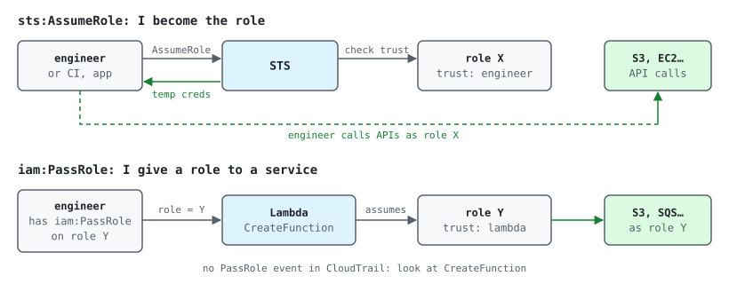

Most AWS permission problems come down to a few ideas: who is calling, which
policy allows it, and who is allowed to become which role. This post builds them
up from zero. Account numbers like `111122223333` are placeholders. IRSA and
Pod Identity in [KEDA on EKS](../keda-eks-event-driven-autoscaling/) rely on
these ideas.

## TL;DR

- **Principal** = who makes a request: an **IAM user**, a **role session**, a
  **federated / SSO user**, or an **AWS service**.
- **IAM user** = long-term identity (password and/or access keys). **IAM role** =
  identity with **no long-term credentials**; you **assume** it and get
  **temporary credentials** from STS. Prefer roles + SSO; avoid users with access keys.
- **Policy** = a JSON document: `Effect` + `Action` + `Resource` (+ `Condition`).
  Identity policies are attached to a user/group/role; resource policies (S3
  bucket, KMS key, SQS queue, **role trust policy**) are attached to the resource
  and have a `Principal`.
- A **role** has two sides: the **trust policy = WHO can assume it**, the
  **permissions policy = WHAT it can do**.
- **sts:AssumeRole** = *I become the role*. **iam:PassRole** = *I give a role to an
  AWS service* (Lambda, EC2, EKS, ECS) and the service assumes it later. PassRole
  is a **permission, not an API call**, so it never shows in CloudTrail by itself.
- The default is **deny**. An **explicit Deny** anywhere wins. Cross-account
  access needs **both** sides to allow.

## How AWS decides allow or deny

Simplified, for one request in one account:

1. **Explicit Deny** in any policy (SCP, RCP, permissions boundary, session,
   identity, resource)? → **DENY**.
2. The organization's **SCP / RCP** doesn't allow it? → **DENY** (implicit).
3. A **resource policy** allows this principal (same account)? → **ALLOW**.
4. No **identity policy** allows it? → **DENY** (implicit).
5. The **permissions boundary** doesn't allow it? → **DENY**.
6. The **session policy** (if the role session has one) doesn't allow it? → **DENY**.
7. Otherwise → **ALLOW**.

> **Cross-account rule.** If the principal is in account A and the resource is in
> account B, the **identity policy in A** AND the **resource policy (or role
> trust policy) in B** must both allow. One side alone is not enough.

## 1. The pieces

| Piece | What it is | Credentials | Typical use |
| --- | --- | --- | --- |
| Root user | The account owner (email login) | Password + MFA | Only for a few account tasks. Lock it away |
| IAM user | Long-term identity in one account | Console password, access keys (`AKIA…`) | Legacy, break-glass, some third-party tools. Prefer SSO |
| IAM group | Collection of users to attach policies once | None (not a principal) | "developers", "readonly". A group cannot be a policy `Principal` |
| IAM role | Identity you assume; trust policy + permissions | Temporary (`ASIA…` key with a session token), 15 min – 12 h | Humans via SSO, EC2/Lambda/ECS/EKS pods, CI (GitHub OIDC), cross-account |
| Service-linked role | Role owned by a service, predefined permissions (`AWSServiceRoleFor…`) | Temporary | Auto Scaling, ELB, EKS. You can't edit its policy |
| Instance profile | Container that puts one role on an EC2 instance | Via IMDS on the instance | EC2 / EKS nodes. Needs PassRole to attach |
| STS | Security Token Service: issues temporary credentials | — | `AssumeRole`, `AssumeRoleWithWebIdentity` (OIDC, IRSA), `AssumeRoleWithSAML` (SSO) |

### Policy types

| Type | Attached to | Has Principal? | Note |
| --- | --- | --- | --- |
| AWS managed policy | User / group / role | No | e.g. `ReadOnlyAccess`. Broad; AWS updates it |
| Customer managed policy | User / group / role (reusable, versioned) | No | Preferred for your own permissions (Terraform) |
| Inline policy | Exactly one user / group / role | No | Dies with the identity. OK for strict 1:1 cases |
| Resource-based policy | S3 bucket, KMS key, SQS, SNS, Lambda, ECR… | **Yes** | Grants access to other principals, including other accounts |
| Role trust policy | The role itself | **Yes** | A resource policy on the role: who can assume it |
| Permissions boundary | User / role | No | Maximum permissions; does **not** grant anything by itself |
| SCP / RCP | AWS Organizations OU / account | No | Guardrails for the whole account; they don't grant |
| Session policy | Passed in the `AssumeRole` call | No | Narrows one session further |

## 2. Anatomy of a policy

```json
{
  "Version": "2012-10-17",
  "Statement": [
    {
      "Sid": "ReadAppBucket",
      "Effect": "Allow",
      "Action": ["s3:GetObject", "s3:ListBucket"],
      "Resource": [
        "arn:aws:s3:::app-uploads",
        "arn:aws:s3:::app-uploads/*"
      ],
      "Condition": {
        "StringEquals": { "aws:RequestedRegion": "ap-southeast-1" }
      }
    }
  ]
}
```

- `Effect`: `Allow` or `Deny`. `Action`: `service:Operation`, wildcards allowed
  (`s3:Get*`). `Resource`: ARNs. `Condition`: operators like `StringEquals`,
  `StringLike`, `ArnLike`, `Bool`, keys like `aws:SourceIp`, `aws:PrincipalOrgID`,
  `aws:MultiFactorAuthPresent`.
- `Version` must be `2012-10-17` (the older version disables policy variables).
- Watch the bucket vs object ARN: `ListBucket` needs `arn:aws:s3:::bucket`,
  `GetObject` needs `arn:aws:s3:::bucket/*`. A classic mistake.

## 3. A role = trust policy + permissions policy

The trust policy says WHO. Three common principal types:

**a) A role in another account (cross-account, humans, CI):**

```json
{ "Effect": "Allow",
  "Principal": { "AWS": "arn:aws:iam::111122223333:role/ci-deployer" },
  "Action": "sts:AssumeRole",
  "Condition": { "StringEquals": { "sts:ExternalId": "acme-123" } } }
```

**b) An AWS service (used together with PassRole):**

```json
{ "Effect": "Allow",
  "Principal": { "Service": "lambda.amazonaws.com" },
  "Action": "sts:AssumeRole" }
```

**c) An OIDC provider (EKS IRSA, GitHub Actions):**

```json
{ "Effect": "Allow",
  "Principal": { "Federated": "arn:aws:iam::111122223333:oidc-provider/oidc.eks.ap-southeast-1.amazonaws.com/id/ABC" },
  "Action": "sts:AssumeRoleWithWebIdentity",
  "Condition": { "StringEquals": {
    "oidc.eks.ap-southeast-1.amazonaws.com/id/ABC:sub": "system:serviceaccount:orders:worker",
    "oidc.eks.ap-southeast-1.amazonaws.com/id/ABC:aud": "sts.amazonaws.com" } } }
```

The permissions policy says WHAT: any identity policy attached to the role
(managed or inline), like the example in section 2.

> **Careful:** `"Principal": {"AWS": "arn:aws:iam::111122223333:root"}` means
> **the whole account** (any principal there whose own policy allows
> `sts:AssumeRole`), not the root user. Prefer a specific role ARN.

## 4. AssumeRole vs PassRole



|  | sts:AssumeRole | iam:PassRole |
| --- | --- | --- |
| Meaning | I become the role and use its temporary credentials | I let a service use the role on my behalf |
| Who gets the credentials | The caller | The service (Lambda, EC2, EKS, ECS, CodeBuild…) |
| API call? | Yes (STS API) | No, a permission checked during `CreateFunction`, `RunInstances`, `CreateCluster`, `RegisterTaskDefinition`… |
| Checks | Caller's identity policy (cross-account) + the role's trust policy | Caller's identity policy (`iam:PassRole` on the role ARN) + role trust must allow the service |
| CloudTrail | `AssumeRole` event | No event of its own; see the create/update event of the resource |
| Cross-account | Yes | No, same account only |
| Protects against | Anyone using a role they shouldn't | Privilege escalation: attaching an admin role to a Lambda/EC2 you create |

Least-privilege PassRole (only this role, only to Lambda):

```json
{
  "Effect": "Allow",
  "Action": "iam:PassRole",
  "Resource": "arn:aws:iam::111122223333:role/lambda-exec-orders",
  "Condition": { "StringEquals": { "iam:PassedToService": "lambda.amazonaws.com" } }
}
```

The error you get without it:

```txt
AccessDeniedException: User: arn:aws:sts::111122223333:assumed-role/dev/jane
is not authorized to perform: iam:PassRole on resource: arn:aws:iam::111122223333:role/lambda-exec-orders
```

## 5. Example: an app reading a customer's S3 bucket

A classic cross-account chain, used by apps that read data in a customer's AWS account:

1. **Role 1** in your account: trust = the app's Kubernetes ServiceAccount via
   IRSA; permissions = `sts:AssumeRole` on the customer's role.
2. **Role 2** in the customer's account: trust = the Role 1 ARN (ideally with an
   `ExternalId`); permissions = S3 read on the bucket, plus `kms:Decrypt` if the
   bucket uses SSE-KMS.
3. The app gets Role 1 credentials from IRSA, calls `sts:AssumeRole` into Role 2,
   then reads the bucket.

Similarly, creating an EKS cluster or node group (eksctl / Terraform) needs
`iam:PassRole` on the cluster role and the node role.

## 6. Design choices

| Choice | Options | When to pick what |
| --- | --- | --- |
| Humans | IAM Identity Center (SSO) permission sets · IAM users | SSO: short-lived credentials, one login for many accounts. IAM users only for break-glass |
| CI/CD | OIDC role (GitHub/GitLab) · access keys in secrets | OIDC role with the trust limited to repo + branch (`sub`). No keys to rotate |
| Pods on EKS | IRSA · EKS Pod Identity · node role | A per-ServiceAccount role via IRSA or Pod Identity. Never rely on the node role for apps; block IMDS for pods |
| Managed vs inline | Customer managed · inline | Managed by default (reusable, versioned, visible). Inline for strict 1:1 cases |
| Cross-account | Role in the target + AssumeRole · resource policy | A role when many services/APIs are needed; a resource policy for one bucket/key/queue. Add `ExternalId` for third parties |

## 7. Gotchas

- **AccessDenied on cross-account AssumeRole:** check both sides: the caller has
  `sts:AssumeRole` on the role ARN, **and** the role trust lists the caller.
- **Changed trust/permissions but still denied:** existing sessions keep their old
  credentials until they expire, and policy changes can take a few seconds to
  propagate.
- **Role chaining** (role → role) limits the session to **1 hour**, whatever the
  maximum session duration.
- **Explicit Deny wins** (SCP, boundary, bucket policy). An Allow in the role does
  not help.
- **KMS:** S3 objects with SSE-KMS also need `kms:Decrypt` / `GenerateDataKey`,
  **and** the key policy must allow the principal.
- **PassRole on all resources (`*`)** is almost admin. Always scope it to role
  ARNs + `iam:PassedToService`.
- **A recreated role with the same name** gets a new unique ID; resource policies
  that referenced the old role silently stop matching.
- **Don't use tags** (`iam:ResourceTag`) to control PassRole; AWS says the results
  are not reliable.

## 8. How to check yourself

```bash
P=<profile>; ROLE=lambda-exec-orders

# Who am I right now? (user, or assumed-role session)
aws sts get-caller-identity --profile $P

# Role: trust policy, attached + inline policies
aws iam get-role --role-name $ROLE --profile $P --query 'Role.AssumeRolePolicyDocument'
aws iam list-attached-role-policies --role-name $ROLE --profile $P
aws iam list-role-policies --role-name $ROLE --profile $P
aws iam get-role-policy --role-name $ROLE --policy-name <inline-name> --profile $P

# Managed policy JSON (default version)
ARN=<policy-arn>
V=$(aws iam get-policy --policy-arn $ARN --profile $P --query 'Policy.DefaultVersionId' --output text)
aws iam get-policy-version --policy-arn $ARN --version-id $V --profile $P

# Try to assume a role
aws sts assume-role --role-arn arn:aws:iam::111122223333:role/$ROLE --role-session-name test --profile $P

# Would this principal be allowed? (policy simulator)
aws iam simulate-principal-policy --profile $P \
  --policy-source-arn arn:aws:iam::111122223333:role/dev \
  --action-names iam:PassRole lambda:CreateFunction \
  --resource-arns arn:aws:iam::111122223333:role/$ROLE

# CloudTrail: recent AssumeRole calls
aws cloudtrail lookup-events --profile $P --max-results 20 \
  --lookup-attributes AttributeKey=EventName,AttributeValue=AssumeRole
```

## 9. Test yourself

<details>
<summary>Q1. What are the two policies of a role, and what does each answer?</summary>

Trust policy = WHO can assume it (it has a Principal). Permissions policy = WHAT
the role can do once assumed.
</details>

<details>
<summary>Q2. When do you need iam:PassRole instead of sts:AssumeRole?</summary>

When you give a role to a service (Lambda execution role, EC2 instance profile,
ECS task role, EKS cluster/node role). You don't use the credentials; the service does.
</details>

<details>
<summary>Q3. Why can't you find PassRole in CloudTrail?</summary>

It is a permission, not an API. Look at the event that created or updated the
resource (`CreateFunction`, `RunInstances`, `CreateCluster`); the role ARN is in
`requestParameters`.
</details>

<details>
<summary>Q4. A role in account A wants to read a bucket in account B. What must exist?</summary>

An Allow in A's identity policy for the S3 actions AND an Allow in B's bucket
policy for A's role (or a role in B that trusts A, assumed via sts:AssumeRole).
Plus the KMS key policy if the bucket uses SSE-KMS.
</details>

<details>
<summary>Q5. A role has AdministratorAccess but S3 still denies. Name three reasons.</summary>

An explicit Deny in the bucket policy, an SCP or a permissions boundary; a KMS
key policy that doesn't allow the role; or an old session / a restrictive
session policy.
</details>

<details>
<summary>Q6. What does Principal AWS arn:aws:iam::111122223333:root allow?</summary>

Any principal in that account whose own identity policy allows sts:AssumeRole on
this role. It delegates the decision to that account; it is not just the root user.
</details>

## Sources

- IAM: [Identities](https://docs.aws.amazon.com/IAM/latest/UserGuide/id.html) · [IAM roles](https://docs.aws.amazon.com/IAM/latest/UserGuide/id_roles.html) · [Policies and permissions](https://docs.aws.amazon.com/IAM/latest/UserGuide/access_policies.html) · [Policy evaluation logic](https://docs.aws.amazon.com/IAM/latest/UserGuide/reference_policies_evaluation-logic.html)
- PassRole: [Pass a role to an AWS service](https://docs.aws.amazon.com/IAM/latest/UserGuide/id_roles_use_passrole.html) · [IAM condition keys](https://docs.aws.amazon.com/IAM/latest/UserGuide/reference_policies_iam-condition-keys.html)
- STS: [AssumeRole](https://docs.aws.amazon.com/STS/latest/APIReference/API_AssumeRole.html) · [AssumeRoleWithWebIdentity](https://docs.aws.amazon.com/STS/latest/APIReference/API_AssumeRoleWithWebIdentity.html) · [Confused deputy / ExternalId](https://docs.aws.amazon.com/IAM/latest/UserGuide/confused-deputy.html)
- Best practices: [Security best practices in IAM](https://docs.aws.amazon.com/IAM/latest/UserGuide/best-practices.html) · [EKS IAM best practices](https://docs.aws.amazon.com/eks/latest/best-practices/identity-and-access-management.html)
