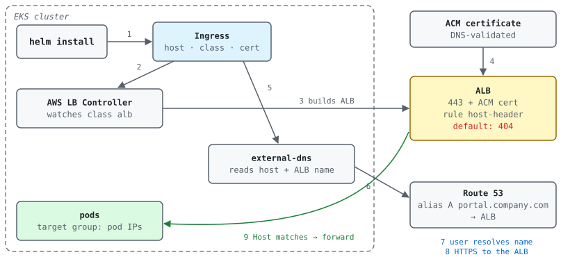

An Ingress on EKS touches four systems: Kubernetes, the AWS Load Balancer
Controller, ACM and Route 53. This post follows one request end to end. The
example everywhere: an app called `portal` on EKS, public name
`portal.company.com`, DNS zone `company.com` in Route 53. Account numbers like
`111122223333` are placeholders.

## TL;DR

- An **Ingress** is only a request written in YAML: "send HTTPS for host
  `portal.company.com` to Service `portal`, using certificate X". Nothing
  happens until a **controller** acts on it.
- On AWS the **AWS Load Balancer Controller** reads the Ingress and builds the
  real **ALB**: listeners, the certificate on HTTPS, a **host-header rule**, and a
  target group with the pod IPs.
- The **certificate** lives in **ACM**. The controller takes it from the
  `certificate-arn` annotation, or finds it by host name (*certificate
  discovery*). With DNS validation in Route 53 it renews by itself.
- The **DNS record** is separate. **external-dns** can read the same Ingress and
  write an **alias record** `portal.company.com → ALB` in Route 53. Without it,
  someone creates the record by hand or in Terraform.
- The ALB routes by **Host header**. Any other name, even the ALB's own
  `…elb.amazonaws.com` name, gets **404**. Host in the Ingress = DNS name = name
  on the certificate.

## Overview

The numbers match the steps in section 3.



## 1. The pieces

| Piece | What it is | Who creates it |
| --- | --- | --- |
| Ingress | Kubernetes object: host + path → Service, plus annotations for the load balancer | You (YAML, usually rendered by Helm) |
| IngressClass | Cluster-wide object that maps a class name (`alb`) to a controller (`ingress.k8s.aws/alb`). The Ingress picks it with `spec.ingressClassName` | Installed once per cluster with the controller |
| AWS Load Balancer Controller | Pod in `kube-system` that watches Ingresses of its class and calls the ELB API | Platform team, once per cluster (needs an IAM role) |
| ALB listener / rule / target group | Listener = port + protocol (80, 443 + cert). Rule = condition (host-header, path) → action. Target group = where traffic goes | The controller |
| ACM certificate | Public TLS cert managed by AWS, in the same region as the ALB | You, once, validated by DNS |
| Route 53 hosted zone | The DNS zone `company.com` | Platform / network team |
| Alias record | Route 53 record type that points a name to an AWS resource and follows its IPs | external-dns, Terraform or a human |
| external-dns | Pod that watches Ingresses/Services and writes DNS records for their hosts | Platform team, optional |

## 2. What you write

A minimal Ingress for the AWS Load Balancer Controller:

```yaml
apiVersion: networking.k8s.io/v1
kind: Ingress
metadata:
  name: portal
  namespace: portal
  annotations:
    alb.ingress.kubernetes.io/scheme: internet-facing          # public ALB (internal = private)
    alb.ingress.kubernetes.io/target-type: ip                  # targets = pod IPs
    alb.ingress.kubernetes.io/listen-ports: '[{"HTTP": 80}, {"HTTPS": 443}]'
    alb.ingress.kubernetes.io/ssl-redirect: '443'              # 80 → 301 to 443
    alb.ingress.kubernetes.io/certificate-arn: arn:aws:acm:us-west-2:111122223333:certificate/abcd-1234
    # alb.ingress.kubernetes.io/group.name: public             # optional: share one ALB with other Ingresses
spec:
  ingressClassName: alb
  rules:
  - host: portal.company.com
    http:
      paths:
      - path: /
        pathType: Prefix
        backend:
          service:
            name: portal
            port:
              number: 80
```

With Helm, the host and the certificate usually come from values, so the same
chart works for every environment:

```yaml
# values-prod.yaml
ingress:
  host: portal.company.com
  certificateArn: arn:aws:acm:us-west-2:111122223333:certificate/abcd-1234
```

```yaml
# templates/ingress.yaml (excerpt)
metadata:
  annotations:
    {{- with .Values.ingress.certificateArn }}
    alb.ingress.kubernetes.io/certificate-arn: {{ . | quote }}
    {{- end }}
spec:
  rules:
  - host: {{ .Values.ingress.host | quote }}
```

> **Pattern: build the host from the namespace.** Some charts write a
> placeholder in values, e.g. `host: <NAMESPACE>.company.com`, and the template
> does `replace "<NAMESPACE>" .Release.Namespace`. `.Release.Namespace` is the
> `-n` flag of `helm install`, so `helm install … -n portal` gives
> `portal.company.com`. Nobody types the full host, but a typo in `-n` silently
> gives a wrong host. Always run `helm template … -n <ns>` first.

## 3. What happens, step by step

1. **helm install.** Helm renders the Ingress and sends it to the Kubernetes API.
2. **Controller reads the Ingress.** `ingressClassName: alb` → the AWS Load
   Balancer Controller owns it. Ingresses of other classes (e.g. nginx) are ignored.
3. **ALB is built.** The controller creates (or reuses, with `group.name`) an ALB
   in subnets tagged `kubernetes.io/role/elb=1`, listeners 80/443, a rule
   `host-header = portal.company.com → forward`, a target group with the pod IPs,
   and a default action **404**.
4. **Certificate on HTTPS:443.** From the `certificate-arn` annotation, or, if it
   is missing, ACM certs matching the Ingress hosts are discovered.
5. **external-dns reads the host** (optional) plus the ALB DNS name from
   `status.loadBalancer`.
6. **Route 53 record.** external-dns writes an **alias A record**
   `portal.company.com → ALB` and a **TXT** record that marks the record as its
   own. Without external-dns this step is manual or Terraform.
7. **User resolves the name.** Route 53 answers with the ALB's current IPs.
8. **HTTPS to the ALB.** TLS ends on the ALB with the ACM certificate. The
   request keeps its `Host` header. Traffic ALB → pod is plain HTTP unless you set
   `backend-protocol: HTTPS`.
9. **Host-based routing.** Host matches the rule → forward to the pods. Anything
   else → default 404.

## 4. Manual vs automatic

| Task | Fully automated setup | Minimal setup |
| --- | --- | --- |
| Write host + cert ARN in values | Manual (once per app/env) | Manual |
| Deploy (`helm install` / upgrade) | CI or ArgoCD | Engineer by hand |
| ALB, listeners, rules, target group | Automatic (controller) | Automatic (controller) |
| Cert on the HTTPS listener | Automatic (annotation or discovery) | Automatic (annotation) |
| Cert issue + renewal | Terraform + DNS validation: renews by itself | Console; email validation needs a human at every renewal (see [ACM certificate validation](../acm-certificate-validation-email-dns-http/)) |
| DNS record | Automatic (external-dns, alias record) | Manual CNAME / alias, updated by hand if the ALB is recreated |

## 5. Design choices

| Choice | Options | When to pick what |
| --- | --- | --- |
| ALB per Ingress or shared | Default: **one ALB per Ingress**. `group.name`: many Ingresses share **one ALB** | Many small apps → a shared group saves cost and ALB quota. Strong isolation (separate SGs, WAF, blast radius) → one ALB each. A broken Ingress in a group can block updates for the whole group |
| Which cert | Explicit ARN · discovery by host · wildcard `*.company.com` | Explicit ARN = predictable. Discovery = less config, but a new matching cert can be picked up. A wildcard covers **one level** only |
| DNS record type | **Alias A/AAAA** (Route 53 only) · CNAME | Alias: free queries to AWS targets, works at the zone apex, follows the ALB. CNAME: any DNS provider, not allowed at the apex |
| Who writes DNS | external-dns · Terraform · manual | external-dns when apps come and go often; Terraform when DNS must be reviewed in PRs; manual only for one-offs |
| Target type | `ip` · `instance` | `ip` is the usual choice on EKS with the VPC CNI and Fargate; `instance` needs a NodePort Service |

## 6. Gotchas

- **Host ≠ DNS name = 404.** Testing with the raw ALB DNS name returns 404 by
  design. Use `curl -k -H 'Host: portal.company.com' https://<alb-dns>` to test
  before DNS is ready.
- **Cert in the wrong region** or not covering the host: the ALB still comes up;
  browsers show a certificate error.
- **Missing subnet tags.** Without `kubernetes.io/role/elb=1` (public) or
  `kubernetes.io/role/internal-elb=1` (internal), the controller can't place the
  ALB. Check its logs and the Ingress events.
- **IAM.** The controller and external-dns each need their own IAM role (IRSA or
  Pod Identity). external-dns needs `route53:ChangeResourceRecordSets` on the
  zone plus list permissions.
- **IngressClass is cluster-scoped.** Install it once with the controller. If an
  app chart also creates it, a second release of that chart fails.
- **HTTP redirect.** Use the `ssl-redirect: '443'` annotation. A custom
  `actions.*` annotation does nothing unless a path references it.
- **Deleting the Ingress deletes the ALB.** A reinstall gives a **new ALB DNS
  name**. external-dns updates the alias by itself; a manual record now points to
  nothing.
- **external-dns policy.** `sync` also deletes records it owns when the Ingress
  goes away; `upsert-only` never deletes. The TXT owner record stops it from
  touching records it didn't create. Use `--domain-filter=company.com` to limit
  its scope.

## 7. How to check yourself

```bash
CTX=<kube-context>; NS=portal; HOST=portal.company.com; P=<read-only-profile>; R=us-west-2

# Before deploying: what Helm will render
helm template portal ./chart -n $NS -f values-prod.yaml | grep -E '^kind:|host:|certificate-arn|ingressClassName'

# Class and controller
kubectl --context $CTX get ingressclass
kubectl --context $CTX -n kube-system get deploy aws-load-balancer-controller external-dns

# Ingress: host, cert, ALB address, events (errors show here)
kubectl --context $CTX -n $NS get ingress -o wide
kubectl --context $CTX -n $NS describe ingress portal | sed -n '/Annotations/,$p'

# ALB: listeners + certs
LB=$(aws elbv2 describe-load-balancers --profile $P --region $R \
  --query "LoadBalancers[?contains(DNSName, '$(kubectl --context $CTX -n $NS get ingress portal -o jsonpath='{.status.loadBalancer.ingress[0].hostname}' | cut -d. -f1)')].LoadBalancerArn" --output text)
aws elbv2 describe-listeners --load-balancer-arn $LB --profile $P --region $R \
  --query 'Listeners[].{port:Port,proto:Protocol,cert:Certificates[0].CertificateArn}' --output table

# Route 53: the alias record and the external-dns TXT owner record
ZONE=$(aws route53 list-hosted-zones-by-name --dns-name company.com --profile $P --query 'HostedZones[0].Id' --output text)
aws route53 list-resource-record-sets --hosted-zone-id $ZONE --profile $P \
  --query "ResourceRecordSets[?contains(Name, 'portal')].{name:Name,type:Type,alias:AliasTarget.DNSName,txt:ResourceRecords[0].Value}" --output table

# From outside: DNS, cert, routing
dig +short $HOST
curl -svI https://$HOST 2>&1 | grep -E 'subject:|issuer:|expire date:|HTTP/'
```

## 8. Test yourself

<details>
<summary>Q1. You applied an Ingress and nothing happened. What do you check first?</summary>

`ingressClassName` (does a controller own that class?), then the
`kubectl describe ingress` events, then the controller logs (subnet tags, IAM,
bad annotation).
</details>

<details>
<summary>Q2. Why does the ALB's own DNS name return 404?</summary>

The ALB only has a host-header rule for `portal.company.com`; every other host
falls to the default action, a fixed 404.
</details>

<details>
<summary>Q3. Alias or CNAME for portal.company.com in Route 53?</summary>

Alias A (and AAAA for dual-stack): free queries to AWS targets, and it follows
the ALB. A CNAME also works for a sub-domain, but not at the zone apex.
</details>

<details>
<summary>Q4. The Ingress was deleted and recreated. What breaks if DNS is manual?</summary>

The new ALB has a new DNS name, so the old record points to a deleted ALB. With
external-dns the record is updated automatically.
</details>

<details>
<summary>Q5. Name two ways to get the certificate onto the listener.</summary>

The `alb.ingress.kubernetes.io/certificate-arn` annotation, or leave it out and
let the controller discover an ACM cert that matches the Ingress host (or
`spec.tls` hosts).
</details>

<details>
<summary>Q6. What does the group.name annotation change?</summary>

Several Ingresses share one ALB: their rules are merged into the same listeners.
Cheaper, but one broken Ingress can block changes for the whole group.
</details>

## Sources

- Kubernetes: [Ingress](https://kubernetes.io/docs/concepts/services-networking/ingress/) · Helm: [Built-in objects](https://helm.sh/docs/chart_template_guide/builtin_objects/)
- AWS Load Balancer Controller: [Ingress annotations](https://kubernetes-sigs.github.io/aws-load-balancer-controller/latest/guide/ingress/annotations/), [Certificate discovery](https://kubernetes-sigs.github.io/aws-load-balancer-controller/latest/guide/ingress/cert_discovery/), [Subnet discovery](https://kubernetes-sigs.github.io/aws-load-balancer-controller/latest/deploy/subnet_discovery/)
- external-dns: [AWS / Route 53 tutorial](https://github.com/kubernetes-sigs/external-dns/blob/master/docs/tutorials/aws.md)
- AWS: [Route 53 alias vs non-alias records](https://docs.aws.amazon.com/Route53/latest/DeveloperGuide/resource-record-sets-choosing-alias-non-alias.html), [ALB rule conditions](https://docs.aws.amazon.com/elasticloadbalancing/latest/application/rule-condition-types.html), [ACM DNS validation](https://docs.aws.amazon.com/acm/latest/userguide/dns-validation.html)
