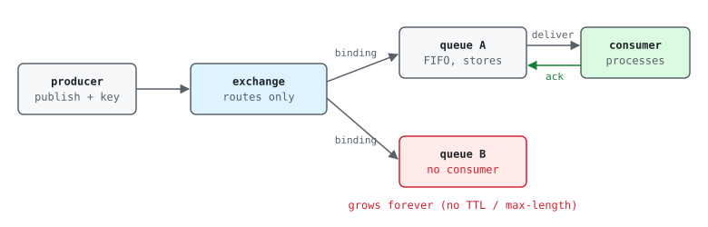
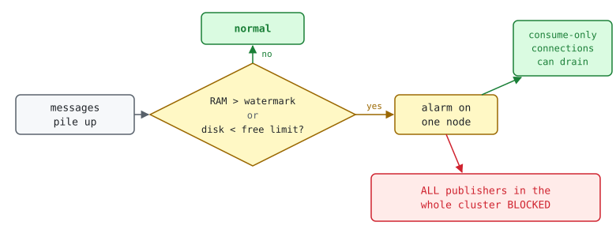

RabbitMQ looks simple until a queue quietly grows to millions of messages. This
post covers where messages actually live, the metrics that show trouble, the two
resource alarms that can stop a whole cluster, and the Amazon MQ specifics.

## TL;DR

- RabbitMQ stores messages **only in queues**. Producers publish to an
  **exchange**; the exchange copies the message to every bound **queue** whose
  binding matches; **consumers** read from queues and **ack**. A "topic" in
  RabbitMQ is just an exchange type, not a place where messages are kept
  (unlike Kafka) ([AMQP concepts](https://www.rabbitmq.com/tutorials/amqp-concepts)).
- If a queue has **no consumer**, messages stay there forever unless a **TTL** or
  **max-length** policy removes them.
- Message bodies live mostly **on disk**; RabbitMQ keeps an **index in RAM**.
- Two safety limits: the **memory high watermark** and the **disk free limit**.
  When either is hit, the broker **blocks every publishing connection in the
  whole cluster**, not just the full queue.
- On Amazon MQ: a 3-node cluster, CloudWatch metrics such as
  `MessageReadyCount`, `RabbitMQMemUsed/Limit`, `RabbitMQDiskFree/Limit`, and a
  weekly **maintenance window** that restarts nodes one by one.

## 1. The message path



| Piece | What it is | Stores messages? |
| --- | --- | --- |
| Connection / channel | One TCP connection per service, many lightweight channels inside it | No |
| Exchange | Router. Type decides how routing keys match bindings: `direct` (exact), `fanout` (all), `topic` (pattern like `scan.*`), `headers` | **No**. If nothing matches, the message is dropped (unless `mandatory` or an alternate exchange) |
| Binding | Rule "exchange X → queue Q for key K" | No |
| Queue | FIFO buffer | **Yes**, until a consumer acks it or a policy removes it |
| Consumer | Subscribes to a queue, processes, then **acks** | No |

See [Exchanges](https://www.rabbitmq.com/docs/exchanges) and [Queues](https://www.rabbitmq.com/docs/queues).

**One exchange, many queues:** when a new service version declares a **new**
queue name but the old queue is still bound to the exchange, every message is
copied to both. The new queue is consumed; the old one fills up forever. This is
a classic cause of a backlog that starts on the day of an upgrade.

## 2. Message states and the metrics that show them

| State | Meaning | Amazon MQ metric | Normal |
| --- | --- | --- | --- |
| Ready | In the queue, waiting for a consumer | `MessageReadyCount` | near 0, short spikes |
| Unacked | Delivered to a consumer, not acked yet | `MessageUnacknowledgedCount` | ≤ consumers × prefetch |
| Total | Ready + Unacked | `MessageCount` | near 0 |

- **Ready grows and never drops** → no consumer, or the consumer is too slow or
  crashing. **Unacked high** → a consumer is stuck mid-work
  ([Consumer Acknowledgements](https://www.rabbitmq.com/docs/confirms)).
- Other useful metrics: `ConsumerCount`, `ConnectionCount`, `QueueCount`,
  `PublishRate`, `AckRate`
  ([Amazon MQ CloudWatch metrics](https://docs.aws.amazon.com/amazon-mq/latest/developer-guide/amazon-mq-accessing-metrics.html)).

## 3. Where messages are stored

| Queue type | Storage | Replication |
| --- | --- | --- |
| Classic (v2, default in 3.13) | Bodies on disk (small ones embedded in the index), **index in RAM** | None (one node) |
| Quorum | Raft log on disk on **every member node** (usually 3) | Yes, a majority must agree |
| Stream | Append-only log on disk, read without removing | Yes |

See [Classic queues](https://www.rabbitmq.com/docs/classic-queues) and
[Quorum queues](https://www.rabbitmq.com/docs/quorum-queues). On Amazon MQ the
disk is the EBS volume of each broker node; you cannot see the files, only the
metrics. The queue type is shown in the management console, column *Type*.

## 4. The two safety limits (resource alarms)



- **Memory high watermark**: the RabbitMQ default is 0.4 × RAM; above it,
  publishers are blocked until memory drops ([Memory alarms](https://www.rabbitmq.com/docs/memory)).
- **Disk free limit**: when free disk on a node goes below it, publishers are
  blocked ([Disk alarms](https://www.rabbitmq.com/docs/disk-alarms)).
- The block is **cluster-wide**: one node in alarm blocks publishers on all nodes
  ([Resource alarms](https://www.rabbitmq.com/docs/alarms)).
- Consumers can still drain the queue, but only on connections that **only
  consume**. A connection that also publishes is blocked too, so RabbitMQ
  recommends separate connections for publishing and consuming.
- Before an alarm, **flow control** can already slow down fast publishers
  ([Flow control](https://www.rabbitmq.com/docs/flow-control)).

### How big is the risk?

Do the math before you panic. A few million small messages in a classic queue
can cost only tens of MB of RAM (the index) and a few GB of disk. Compare the
growth per day with the distance to `RabbitMQMemLimit` and
`RabbitMQDiskFreeLimit`: if the limit is years away, the backlog is a slow risk to
fix in normal work, not an incident. For reference, an `mq.m5.large` has 8 GB
RAM, so 0.4 × 8 GB ≈ 3.2 GB is roughly where the memory limit lands.

## 5. How to stop a queue from growing forever

| Tool | Effect | Set by |
| --- | --- | --- |
| Fix / add the consumer | Queue drains normally | App |
| Unbind or delete the orphan queue | No more copies arrive | Operator (console / API), after confirming nobody needs it |
| Purge | Deletes all messages in the queue now | Operator |
| Message TTL (`x-message-ttl`) | Messages older than N ms are dropped (or dead-lettered) | Policy or queue argument |
| Max length (`x-max-length`, `x-max-length-bytes`) | Oldest messages dropped when full (`drop-head`) or new ones rejected | Policy or queue argument |
| Dead-letter exchange | Expired / rejected messages go to another queue for inspection | Policy |

See [TTL](https://www.rabbitmq.com/docs/ttl), [Max length](https://www.rabbitmq.com/docs/maxlength),
[Dead lettering](https://www.rabbitmq.com/docs/dlx) and [Policies](https://www.rabbitmq.com/docs/policies).

## 6. RPC over RabbitMQ

- Many services use RabbitMQ for request/response: service A publishes a request
  with a **reply-to** queue and a correlation id, service B answers to that queue.
- If no answer comes in time, the caller logs a timeout. Expect these during
  broker maintenance and under node pressure.
- Pure events are fire-and-forget: if the consumer queue is gone or orphaned,
  nothing fails loudly; messages just pile up. That is why `MessageReadyCount`
  needs an alert.

## 7. Amazon MQ specifics

| Topic | What to know |
| --- | --- |
| Deployment | `CLUSTER_MULTI_AZ`: 3 nodes in 3 AZs behind one endpoint |
| Maintenance window | Weekly. AWS restarts nodes **one at a time** → clients see `ReplyCode 320 CONNECTION_FORCED` and must reconnect |
| Auto minor upgrade | If `true`, patches happen in the window without any action from you |
| Metrics | CloudWatch, broker-level and per-queue (labels `Queue`, `VirtualHost`); export them to your monitoring stack with a metric stream |
| Management console | Web UI / HTTP API of the broker; private brokers need VPC access |

See [maintenance window](https://docs.aws.amazon.com/amazon-mq/latest/developer-guide/amazon-mq-rabbitmq-editing-broker-preferences.html)
and [cluster deployment](https://docs.aws.amazon.com/amazon-mq/latest/developer-guide/rabbitmq-broker-architecture.html).

## 8. Worked example: a backlog that started with an upgrade

1. **Symptom:** `MessageReadyCount` on one broker climbs steadily (say +100 k per
   day) while similar brokers stay at 0–2.
2. **Start:** look at the weekly maximum and back-calculate the start date. If it
   matches an app upgrade, and fresh installs of the same version have no
   backlog, an orphan queue left over from the old version is the prime suspect.
3. **Impact:** compare RAM and disk use with the limits (section 4).
4. **Next:** management console → Queues, sort by *Messages*, look for
   *Consumers* = 0; find which exchange feeds it; then unbind or delete and
   purge. Do it before upgrading other environments, or they may get the same
   orphan queue.

## 9. How to check yourself

```txt
# PromQL, with CloudWatch metrics exported to Prometheus-style names
# Ready messages per broker now
max by (Broker) (last_over_time(amazonaws_com_AWS_AmazonMQ_MessageReadyCount_max{Queue=""}[1h]))
# Weekly maximum (growth over time)
max by (Broker) (max_over_time(amazonaws_com_AWS_AmazonMQ_MessageReadyCount_max{Broker="<broker>", Queue=""}[7d]))
# Memory and disk vs limits
max by (Broker, Node) (last_over_time(amazonaws_com_AWS_AmazonMQ_RabbitMQMemUsed_max[1h]))
max by (Broker, Node) (last_over_time(amazonaws_com_AWS_AmazonMQ_RabbitMQMemLimit_max[1h]))
min by (Broker) (last_over_time(amazonaws_com_AWS_AmazonMQ_RabbitMQDiskFree_min[1h]))
# Top queues by depth
topk(10, max by (Broker, Queue) (last_over_time(amazonaws_com_AWS_AmazonMQ_MessageCount_max{Broker="<broker>", Queue!=""}[1h])))
```

```bash
# Broker config (read-only)
aws mq list-brokers --profile <read-only-profile> --region <region> \
  --query "BrokerSummaries[].[BrokerName,BrokerId,DeploymentMode,HostInstanceType]" --output table
aws mq describe-broker --broker-id <id> --profile <read-only-profile> --region <region> \
  --query '{engine:EngineVersion,window:MaintenanceWindowStartTime,autoMinor:AutoMinorVersionUpgrade,console:BrokerInstances[0].ConsoleURL}'

# Queues sorted by depth (management HTTP API, from inside the VPC)
curl -s -u "$MQ_USER:$MQ_PASS" "https://<broker-endpoint>/api/queues?sort=messages&sort_reverse=true&columns=name,type,messages,consumers" | head
```

## Sources

- RabbitMQ: [Exchanges](https://www.rabbitmq.com/docs/exchanges), [Queues](https://www.rabbitmq.com/docs/queues), [Classic queues](https://www.rabbitmq.com/docs/classic-queues), [Quorum queues](https://www.rabbitmq.com/docs/quorum-queues), [Consumer acks](https://www.rabbitmq.com/docs/confirms), [Resource alarms](https://www.rabbitmq.com/docs/alarms), [Memory](https://www.rabbitmq.com/docs/memory), [Disk alarms](https://www.rabbitmq.com/docs/disk-alarms), [Flow control](https://www.rabbitmq.com/docs/flow-control), [TTL](https://www.rabbitmq.com/docs/ttl), [Max length](https://www.rabbitmq.com/docs/maxlength), [Dead lettering](https://www.rabbitmq.com/docs/dlx)
- Amazon MQ: [CloudWatch metrics](https://docs.aws.amazon.com/amazon-mq/latest/developer-guide/amazon-mq-accessing-metrics.html), [broker architecture](https://docs.aws.amazon.com/amazon-mq/latest/developer-guide/rabbitmq-broker-architecture.html)
