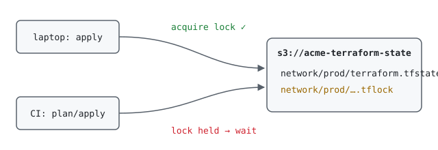

Local `terraform.tfstate` files work until the second person runs `apply`. Remote
state gives the team one source of truth, and locking stops two applies from
corrupting it.



## The backend bucket

Create the bucket once, outside the stacks that use it (a small bootstrap stack
or the console):

```hcl
resource "aws_s3_bucket" "tf_state" {
  bucket = "acme-terraform-state"
}

resource "aws_s3_bucket_versioning" "tf_state" {
  bucket = aws_s3_bucket.tf_state.id
  versioning_configuration { status = "Enabled" }
}

resource "aws_s3_bucket_server_side_encryption_configuration" "tf_state" {
  bucket = aws_s3_bucket.tf_state.id
  rule {
    apply_server_side_encryption_by_default { sse_algorithm = "aws:kms" }
  }
}

resource "aws_s3_bucket_public_access_block" "tf_state" {
  bucket                  = aws_s3_bucket.tf_state.id
  block_public_acls       = true
  block_public_policy     = true
  ignore_public_acls      = true
  restrict_public_buckets = true
}
```

Versioning is your undo button: a bad state write can be rolled back by restoring
the previous object version.

## Configuring the backend

Since Terraform 1.10, the S3 backend can lock with a lock file in the bucket
itself, so a DynamoDB table is no longer required:

```hcl
terraform {
  backend "s3" {
    bucket       = "acme-terraform-state"
    key          = "network/prod/terraform.tfstate"
    region       = "ap-southeast-1"
    encrypt      = true
    use_lockfile = true
  }
}
```

Use one `key` per stack and environment. Smaller states mean faster plans and a
smaller blast radius.

## Migrating existing local state

```bash
terraform init -migrate-state
terraform state list | wc -l    # same count as before?
terraform plan                  # should report: No changes
```

If the plan shows changes right after a migration, stop and investigate before
applying.

## When a lock gets stuck

A crashed CI job can leave the lock behind:

```bash
terraform force-unlock <LOCK_ID>
```

Only do this after confirming no other run is in progress. The lock ID is printed
in the error message.

## IAM for CI

The CI role needs `s3:ListBucket` on the bucket and `s3:GetObject`,
`s3:PutObject`, `s3:DeleteObject` on the state keys, including the `.tflock`
objects. Scope it with the key prefix rather than granting the whole bucket.
